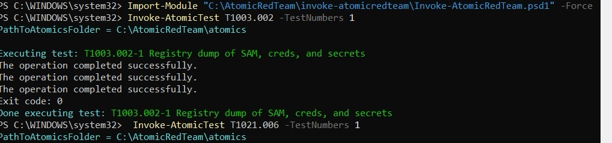
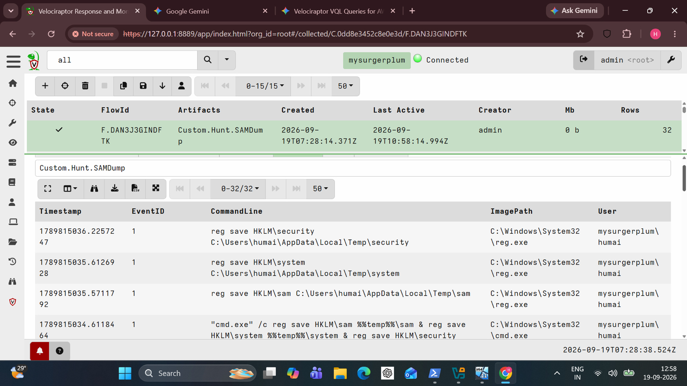
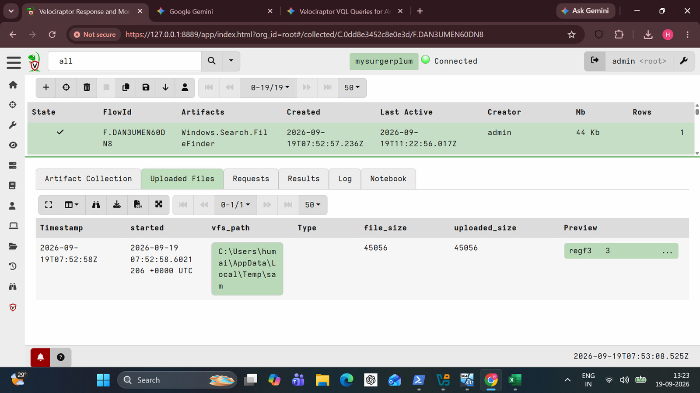
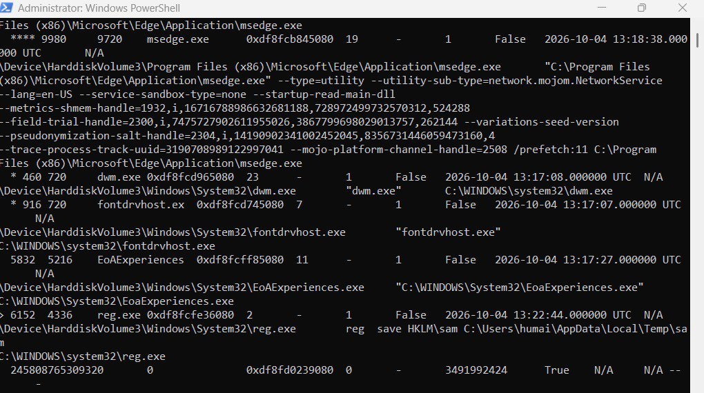
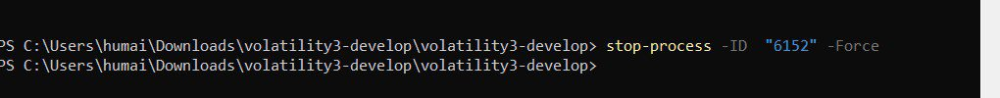

# SAM Registry Dump (T1003.002)

> **The attacker's favorite 3-line heist: copy the registry hives, walk away with every local password hash.**

**Hypothesis:** An attacker with admin rights saves the SAM, SYSTEM and SECURITY hives using `reg.exe` to extract local credential hashes offline.

## Attack Execution

`Invoke-AtomicTest T1003.002 -TestNumbers 1` ran three `reg save` commands. Exit code 0, three "operation completed successfully" lines.



## Detection

`Custom.Hunt.SAMDump` parses Sysmon Event ID 1 and regex-matches `reg save` / `reg export` aimed at the credential hives:

```yaml
parameters:
  - name: TargetRegex
    default: (?i)reg.*(save|export).*(sam|system|security)
...
FROM foreach(
  row={ SELECT OSPath FROM glob(globs=PathGlob) },
  query={ SELECT * FROM parse_evtx(filename=OSPath) }
)
WHERE EventID = 1
  AND CommandLine =~ TargetRegex
```

Full artifact: [`detection-rules/Custom.Hunt.SAMDump.yaml`](../detection-rules/Custom.Hunt.SAMDump.yaml)



`Windows.Search.FileFinder` then located the dumped hive in the user's Temp folder and pulled it back to the server. Velociraptor tagged the upload as a `regf` registry file.



## Forensic Confirmation (Volatility 3)

`windows.pstree` and `windows.cmdline` against the RAM image caught `reg.exe` red-handed: **PID 6152, parent PID 4336**, command line `reg save HKLM\sam C:\Users\humai\AppData\Local\Temp\sam`.

Two independent sources, one process. The endpoint log and the memory image tell the same story.



## Response

The live process was terminated with `Stop-Process -Id 6152 -Force`, using the PID Volatility identified.



**Correction worth stating:** Volatility cannot kill anything in a static dump. It *identifies* the PID. The kill happens on the live host, with PowerShell.

## Dead ends and limits

- The process was a one-shot: `reg.exe` exits in under a second, so a memory capture only catches it if the timing is lucky.
- The regex matches the command line, not intent. An attacker using the API directly, or a renamed `reg.exe`, would slip past it.
- The hive file was uploaded, not cracked or parsed. Nothing here proves the hashes were usable.

## Conclusion

SAM dump simulated, **detected** by a custom VQL hunt, **confirmed** in memory by Volatility 3, and the live process stopped. Two tools, one PID.
