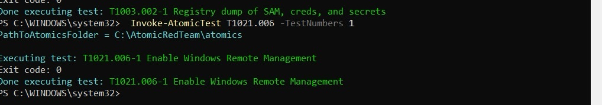
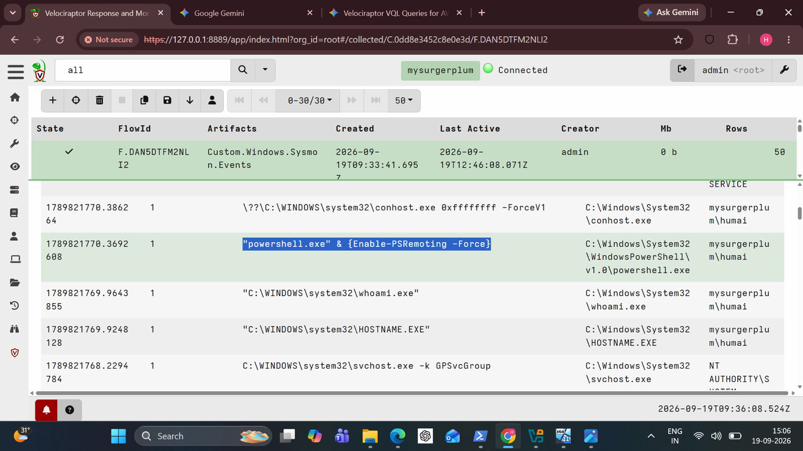
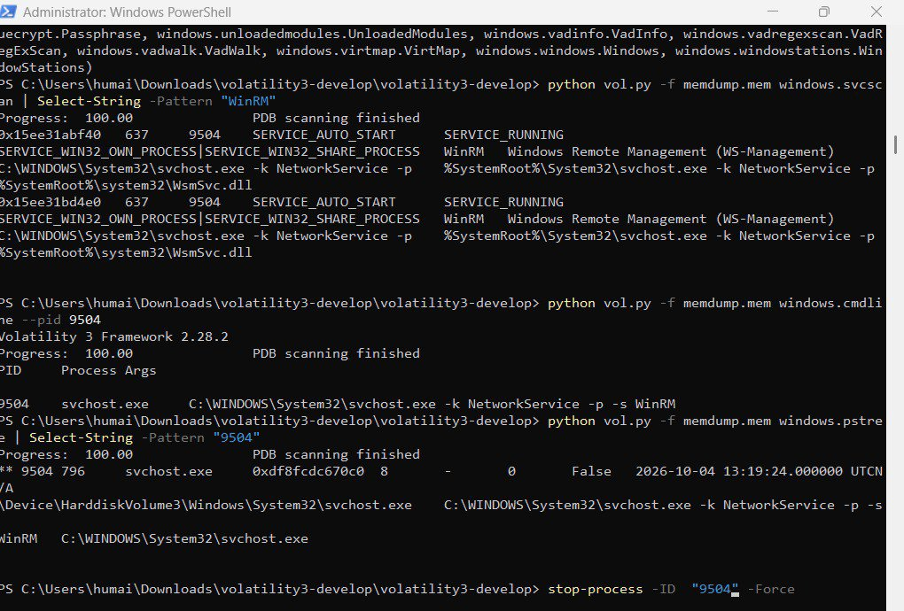

# WinRM Lateral Movement (T1021.006)

> **Before an attacker can hop to another machine, WinRM has to be listening. Catch the door opening.**

**Hypothesis:** An attacker enables Windows Remote Management so they can run commands on other hosts with stolen credentials.

## Attack Execution

`Invoke-AtomicTest T1021.006 -TestNumbers 1` runs `Enable-PSRemoting -Force`. Exit code 0.

## Detection

`Custom.Windows.Sysmon.Events` (Event ID 1) pulled the command line straight out of the Sysmon log: **`powershell.exe & {Enable-PSRemoting -Force}`**, sitting right beside the attacker's classic first moves, `whoami.exe` and `HOSTNAME.EXE`.

Recon, then remote access. In that order, within seconds.

## Forensic Confirmation (Volatility 3)

- `windows.svcscan`: service **WinRM** (WS-Management) running, auto-start, in **PID 9504**.
- `windows.cmdline --pid 9504`: `svchost.exe -k NetworkService -p -s WinRM`.
- `windows.pstree`: PID 9504, **parent PID 796**.

The capture shows no `wsmprovhost.exe` worker. The working theory is that it is an ephemeral process that had already exited. That is not verified.

## Response

`Stop-Process -Id 9504 -Force` on the live host, using the PID from the memory image. (The command is visible at the bottom of the svcscan screenshot.) Volatility found the PID. PowerShell did the stopping.

## Dead ends and limits

- **No second host.** This proves WinRM was enabled and running, not that anyone logged in remotely. Nothing in the evidence shows a remote session, an authentication record or a WinRM operational log entry.
- Stopping a shared `svchost.exe` service host is blunt. On a real system you would disable the service or block 5985/5986, not kill the host process.

## Conclusion

The door was opened (`Enable-PSRemoting`), detected in the Sysmon log, and the WinRM service was confirmed running in memory. Lateral movement itself was **not** demonstrated, and this write-up does not claim it was.
