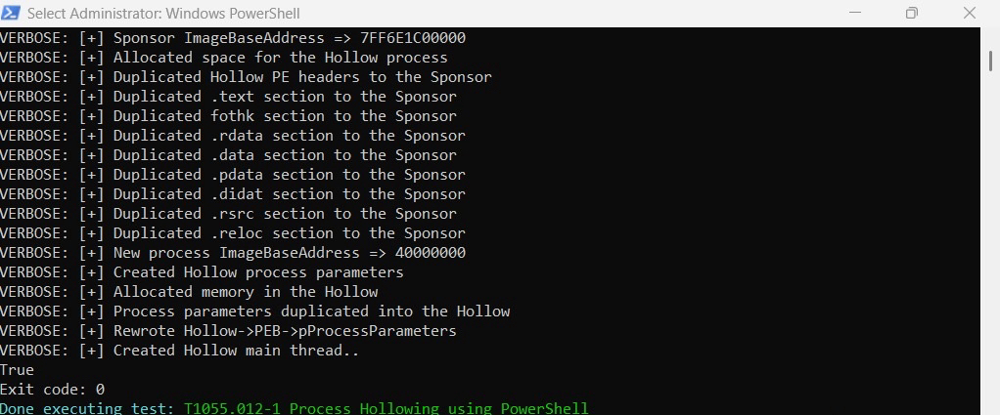
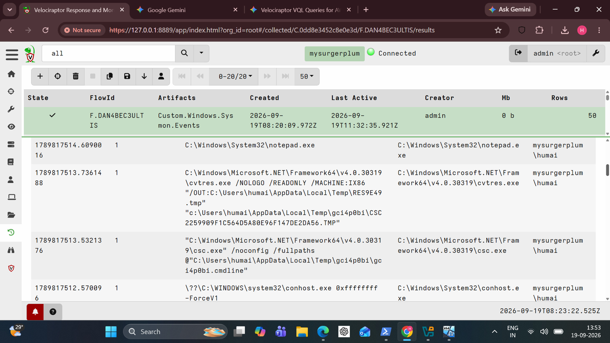
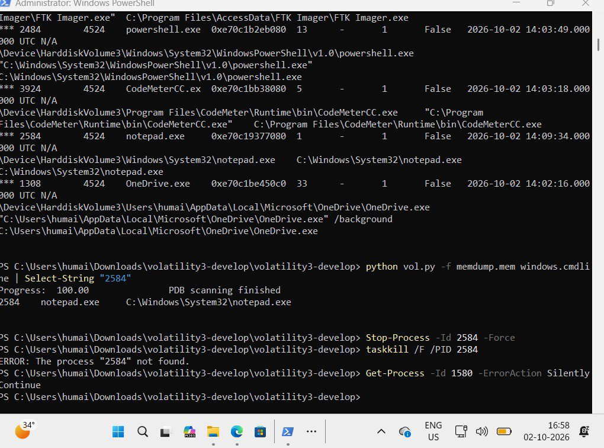

# Process Hollowing (T1055.012)

> **A legitimate `notepad.exe` on the outside. Something else on the inside. Hollowing is the oldest costume party in malware.**

**Hypothesis:** An attacker launches a trusted process suspended, replaces its memory with a payload, and resumes it, so it keeps its good name.

## Attack Execution

`Invoke-AtomicTest T1055.012 -TestNumbers 1` (PowerShell hollowing, run with verbose output). The transcript walks through the technique step by step: allocate space in the sponsor process, duplicate the PE headers and each section (`.text`, `.rdata`, `.data`, `.pdata`, `.rsrc`, `.reloc`), rewrite `PEB->pProcessParameters`, create the main thread. Exit code 0.

## Detection

Sysmon Event ID 1, read with `Custom.Windows.Sysmon.Events`, caught the compiler footprint: **`csc.exe` and `cvtres.exe` firing next to `notepad.exe`**. A text editor has no business near a C# compiler.

`Custom.Hunt.VADAnomalyHunter` ran as a live triage sweep. It is a path heuristic, not real VAD inspection (see [its header](../detection-rules/Custom.Hunt.VADAnomalyHunter.yaml)).

## Forensic Confirmation (Volatility 3)

RAM was captured with FTK Imager.

`windows.pstree` / `windows.cmdline` place **`notepad.exe` at PID 2584, parent PID 4524**, with the plain path `C:\Windows\System32\notepad.exe`.

`windows.malfind` against the notepad PIDs returned nothing.

An empty malfind is **not** a clean bill of health. Hollowing can leave no RWX region that malfind flags, so this is an open question, not a clearance.

## Response

`Stop-Process -Id 2584 -Force`, then `taskkill /F /PID 2584` answered **"The process 2584 not found."** That supports the process being gone.

Volatility identified PID 2584 from a static image. The live host did the killing.

## Dead ends and limits

- The final `Get-Process` check in the screenshot uses PID **1580**, not 2584, so it does not by itself verify the kill. The `taskkill` "not found" line does.
- No comparison against a normal `notepad.exe` memory layout was done, so whether notepad's memory was actually replaced is **not established**.
- Sysmon saw the compiler, not the replaced memory. A hollowing tool that does not compile on the fly would not trigger this hunt.

## Conclusion

The simulation ran, Sysmon caught the compiler tell, Volatility located the process, and the process was terminated. Memory-level proof of the hollow is still open.
