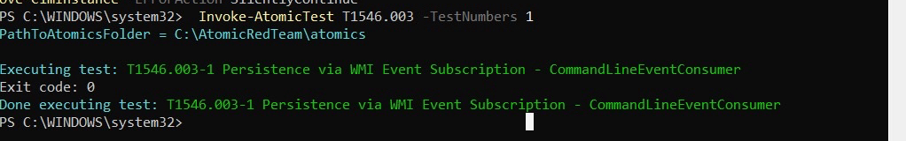
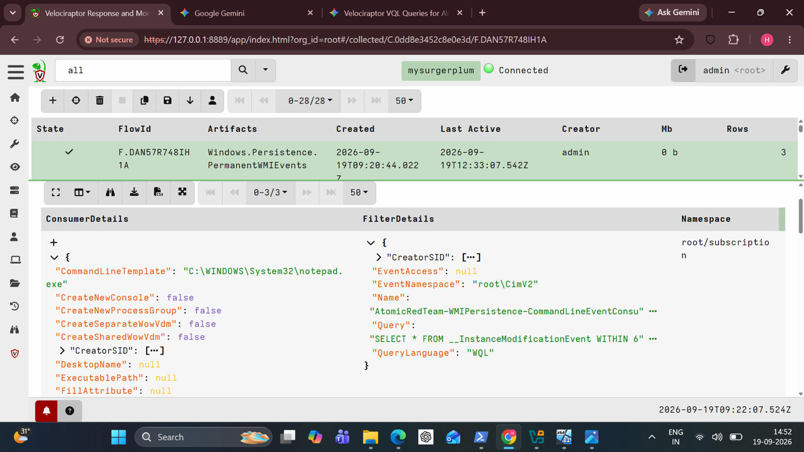
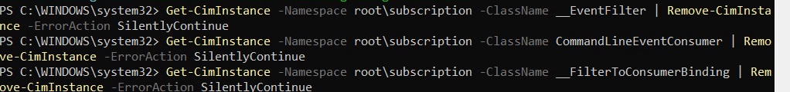

# WMI Persistence (T1546.003)

> **Persistence with no file in Startup, no Run key, no scheduled task. Just three quiet objects in a WMI namespace.**

**Hypothesis:** An attacker plants a permanent WMI event subscription that launches a payload when a trigger fires, so it survives reboots and hides from the usual persistence checks.

## Attack Execution

`Invoke-AtomicTest T1546.003 -TestNumbers 1` created a `CommandLineEventConsumer` subscription (filter + consumer + binding in `root\subscription`). Exit code 0.



## Detection

The built-in artifact **`Windows.Persistence.PermanentWMIEvents`** (no custom VQL needed) listed the subscription with everything a responder wants:

- Consumer: `CommandLineTemplate` = `C:\WINDOWS\System32\notepad.exe`
- Filter query: `SELECT * FROM __InstanceModificationEvent WITHIN 6`, namespace `root\CimV2`
- Filter name carries the Atomic Red Team tag



## Forensic Confirmation

Sysmon also recorded `wmiprvse.exe` activity, the WMI provider host that executes consumers. Memory analysis was not used for this technique.

## Response

Killing the spawned process would leave the subscription in place to fire again. The fix is to delete all three linked objects:

```powershell
Get-CimInstance -Namespace root\subscription -ClassName __EventFilter | Remove-CimInstance
Get-CimInstance -Namespace root\subscription -ClassName CommandLineEventConsumer | Remove-CimInstance
Get-CimInstance -Namespace root\subscription -ClassName __FilterToConsumerBinding | Remove-CimInstance
```



## Dead ends and limits

- The cleanup targets **every** object of each class, not only the lab ones. Fine in a lab, reckless on a production host.
- No enumeration was run after the final test, so a clean state after the last run is not shown.
- No reboot test, so "survives reboot" is the technique's reputation, not something this lab measured.

## Conclusion

Persistence installed, found with a built-in artifact, removed with three commands. Removal is shown between runs; it is not re-verified after the final one.
