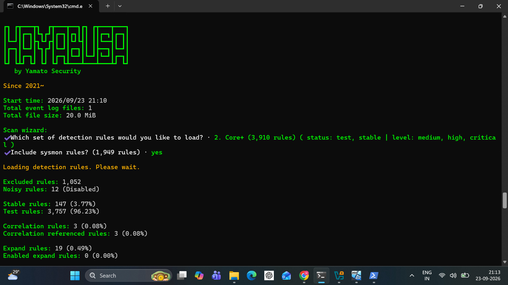
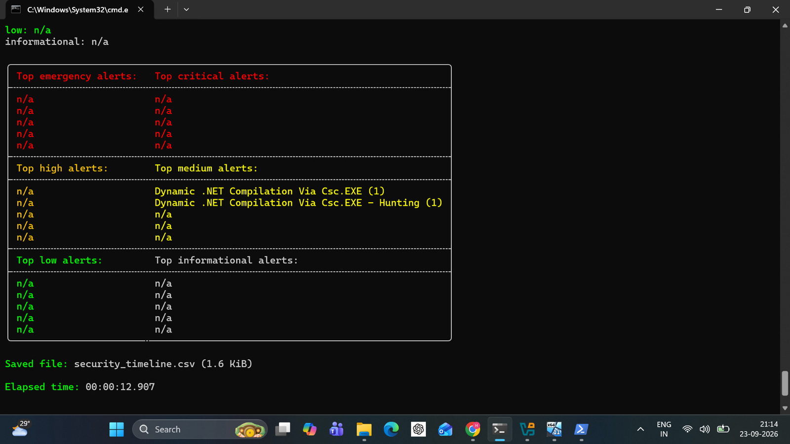

# Hayabusa Cross-Validation

> **Marking your own homework is easy. So I handed the logs to 3,904 rules written by strangers.**

**Hypothesis:** A community Sigma ruleset, which was not written for this lab, flags the same activity the custom hunts found.

## Method

Hayabusa 4.1.0 scanned the collected Security log with the Core+ ruleset (3,910 rules, medium/high/critical) plus Sysmon rules (1,949), 3,904 loaded after exclusions.

## What it found

24,870 events scanned. **One event with hits. Two medium detections**, both titled **Dynamic .NET Compilation Via Csc.EXE**. Same timestamp, Security event 4688, record 238081, for `csc.exe`.

That is one event matched by two rules, not two independent proofs. Honest counting matters.

This lines up with the compiler footprint Sysmon showed in [03-process-hollowing](../03-process-hollowing/). Different tool, different ruleset, same tell.

## The false positive: InventorySvc

A High/Critical WMI alert fired on `svchost.exe` PID 1540 (`-k InvSvcGroup -p -s InventorySvc`), started at boot, 19:54:03 UTC. That is the Windows Inventory Service. Benign.

**Proposed tuning (not deployed):** allow `svchost.exe` from System32 with `InvSvcGroup` + `InventorySvc`, running as `NT AUTHORITY\NETWORK SERVICE` within the boot window. Hayabusa excludes by rule ID, so the filter belongs on a copied rule. It must still alert on the same binary with a different service name, and on the same name run from `%TEMP%`.

## Dead ends and limits

- The InventorySvc alert is described in the case notes (no screenshot kept).
- The CSV export first failed with an unsupported `csv-dump` command and was read with `type` instead.
- `24,870` events is one scan, not a noise or accuracy measurement.
- Hayabusa matched compiler activity. **It did not detect hollowing.**

## Conclusion

An independent ruleset agreed on one event and produced one false positive that was triaged with a concrete, testable filter. Validation, not victory lap.
