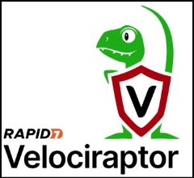
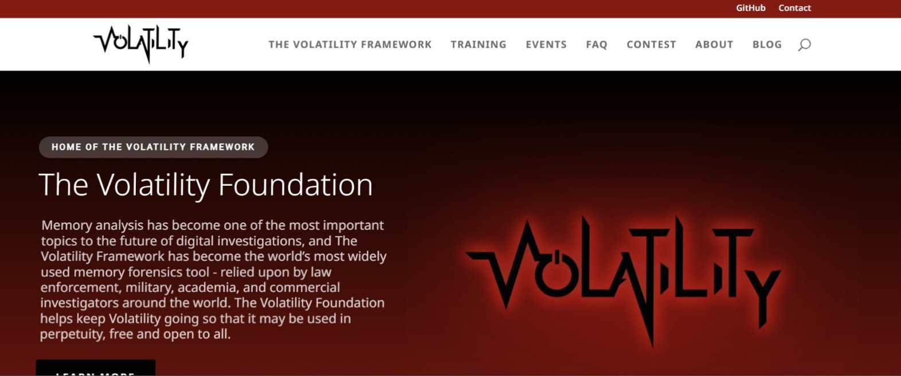
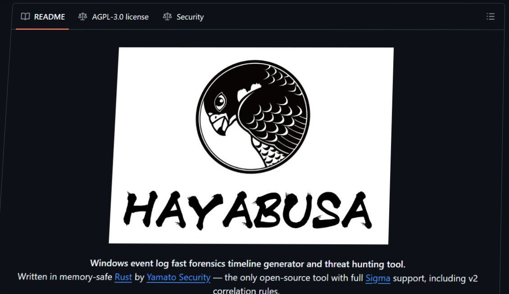

# Velociraptor Threat Hunting & DFIR — SAM Dump, WinRM, Process Hollowing, WMI Persistence

<table>
  <tr>
    <td width="33%" align="center"> <b>Velociraptor</b> — endpoint hunting &amp; response</td>
    <td width="33%" align="center"> <b>Volatility 3</b> — memory forensics</td>
    <td width="33%" align="center"> <b>Hayabusa</b> — Sigma-based log hunting</td>
  </tr>
</table>

Logos and screenshots belong to Rapid7, the Volatility Foundation and Yamato Security. Shown only to credit the tools used.

> **Four attacks. One Windows host. Zero places to hide.**
> Single-host attack simulation and investigation, built from scratch — custom VQL detection, live memory forensics, and independent cross-validation.

**Fire it → catch it → prove it → contain it.**
Four MITRE ATT&CK techniques launched with Atomic Red Team. Caught by three custom Velociraptor artifacts. Pinned to exact PIDs in a RAM image with Volatility 3. Cross-checked against 3,904 community Sigma rules in Hayabusa. Then locked down with quarantine, a 209 MB process dump and disk triage.

## Skills demonstrated

| Skill | Tools |
|---|---|
| Threat Hunting | Velociraptor custom VQL artifacts |
| Memory Forensics | Volatility 3 |
| Log-based Detection | Hayabusa (Sigma rules) |
| Attack Emulation | Atomic Red Team, MITRE ATT&CK |
| Incident Response | Quarantine, memory acquisition, triage |

## Investigations

| # | Technique | ATT&CK | Result |
|---|---|---|---|
| [01](01-sam-registry-dump/) | SAM Registry Dump | T1003.002 | ✅ Corroborated (Velociraptor and Volatility agree on `reg.exe`, PID 6152) |
| [02](02-winrm-lateral-movement/) | WinRM Lateral Movement | T1021.006 | ✅ Corroborated: WinRM turned on, service seen in memory. No second host, so no remote session shown |
| [03](03-process-hollowing/) | Process Hollowing | T1055.012 | 🟡 Simulation and Sysmon corroborated. Memory-level proof still open |
| [04](04-wmi-persistence/) | WMI Persistence | T1546.003 | ✅ Detected + Cleaned (removal not re-checked after the final run) |
| [05](05-hayabusa-cross-validation/) | Hayabusa Cross-Validation | — | ✅ Second opinion agreed, 1 false positive triaged (filter proposed, not deployed) |
| [R](response-and-containment/) | Response & Containment | — | ✅ Quarantine, process dump, SDS triage all ran. Effects not tested |

Each folder above is a standalone case file: **hypothesis → method → findings → dead ends → conclusion.**

## The custom detections

All in [`detection-rules/`](detection-rules/):

| Artifact | What it does |
|---|---|
| `Custom.Windows.Sysmon.Events.yaml` | Parses Sysmon EVTX on the endpoint. One artifact, any Event ID. |
| `Custom.Hunt.SAMDump.yaml` | Regex hunt for `reg save` / `reg export` against SAM, SYSTEM, SECURITY. |
| `Custom.Hunt.VADAnomalyHunter.yaml` | Triage heuristic for suspicious process paths. Not true VAD inspection (see file header). |

## Why a case file says "dead end"

Every investigation lists what did **not** work or could not be proven. A hunt that only reports wins is a demo. This one reports the misses too.

> Screenshots show lab hostnames and usernames. Lab only, no production data.
