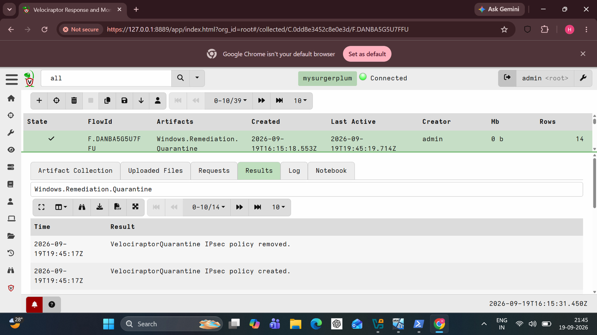
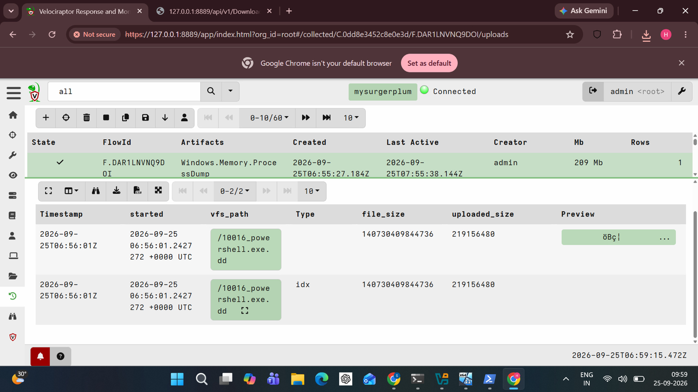
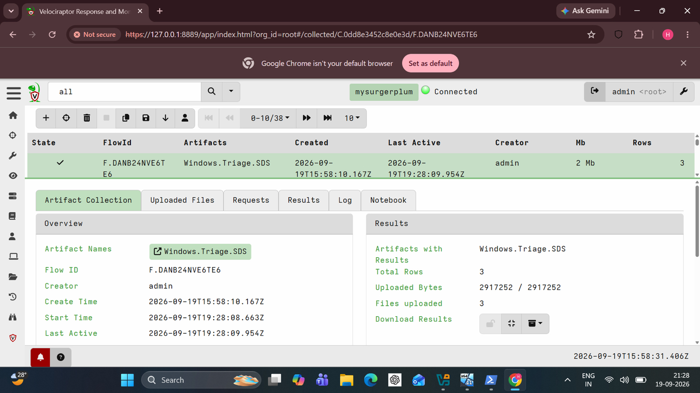

# Response and Containment

> **Finding the attacker is half the job. The other half: lock the door and keep the evidence.**

**Hypothesis:** Once activity is confirmed, the host can be isolated and evidence preserved without losing the volatile data.

All three actions ran from Velociraptor against the lab host.

## 1. Quarantine: `Windows.Remediation.Quarantine`

Log: `VelociraptorQuarantine IPsec policy removed`, then `... policy created`. The policy keeps the Velociraptor channel and essential services open and blocks the rest.

## 2. Memory: `Windows.Memory.ProcessDump`

A targeted dump of `powershell.exe`, **about 209 MB**, uploaded to the server. A single-process dump, not a full RAM image. The RAM image used for the Volatility work was captured separately with FTK Imager.

## 3. Triage: `Windows.Triage.SDS`

KAPE-style NTFS collection: `$SDS`, `$SII`, `$SDH`. Three files, about 2.9 MB uploaded.

## Dead ends and limits

- Policy creation is not a connectivity test. No blocked connection was recorded and the restore step was not checked.
- The process dump and the SDS files were collected, not analysed.

## Conclusion

Isolate, preserve, triage: the full response sequence ran. Whether quarantine actually blocked traffic is untested.
